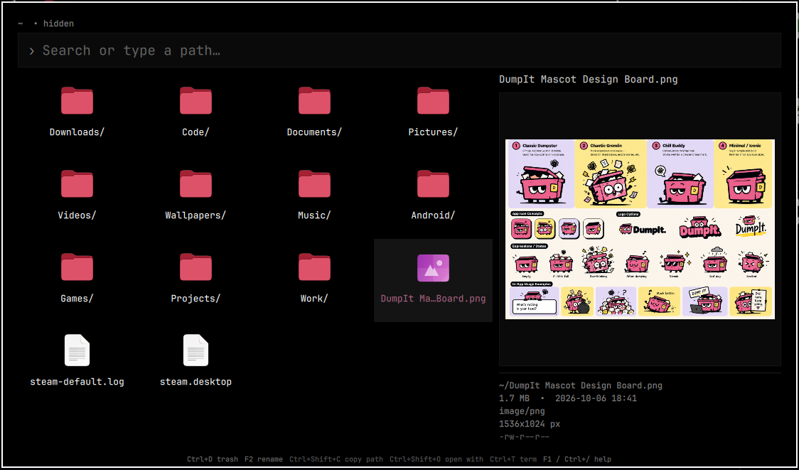
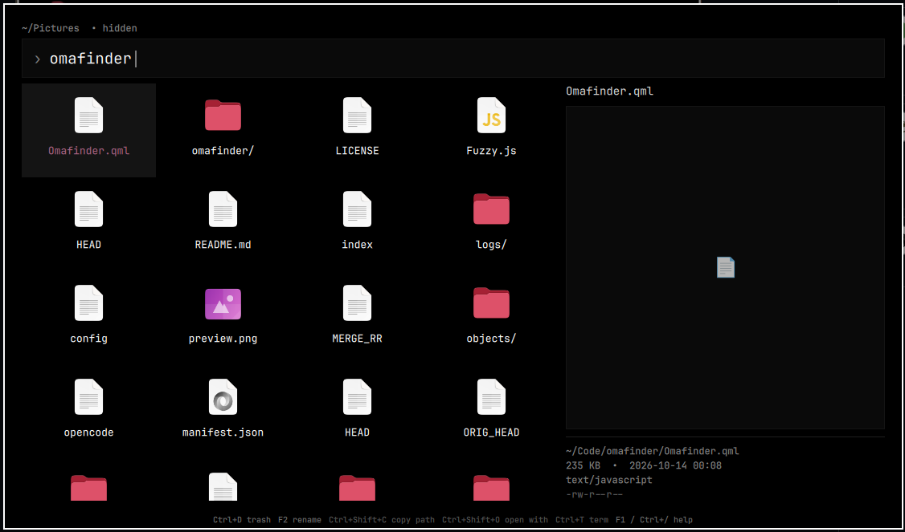

# Omafinder

A keyboard-first file navigator for quickly finding and managing files in Omarchy.

Omafinder is a transient filesystem navigator built for Omarchy. Summon it, find what you need, perform an action, and get out of the way.





## Features

* **Fuzzy file search** across your home directory
* **Fast directory browsing** with directories grouped first
* **Direct path navigation** with paths such as `~/Documents`, `./foo`, and `../bar`
* **Frecency-based ranking** for paths you use frequently or recently
* **Hidden file support**
* **Preview pane** with file thumbnails, text snippets, and file metadata
* **List and tile views** with a remembered toggle
* **Multi-select** with range support for batch actions
* **Drive switcher** for USB sticks and fixed data partitions (mounts on demand, no automount)
* **File operations** without leaving the keyboard:

  * Open
  * Open With
  * Copy
  * Cut
  * Paste
  * Rename
  * New folder
  * New file
  * Trash
  * Copy absolute path
  * Reveal in file manager
  * Open a terminal here
* Persistent navigation state
* Mouse support when you want it
* No background daemon, database, or network service

## Installation

Install Omafinder through the Omarchy plugin system:

```bash
omarchy plugin add https://github.com/Killiivalavan/Omafinder.git --enable
```

After installation, Omafinder is enabled but has no global shortcut by default.

## Opening Omafinder

Open it any time from a terminal (no keybinding needed):

```bash
omarchy-shell shell toggle killie.omafinder
```

### Optional keybinding (suggested: Super+E)

To open Omafinder with one key, add this line to `~/.config/hypr/bindings.lua`:

```lua
o.bind("SUPER + E", "Omafinder", "omarchy-shell shell toggle killie.omafinder")
```

Then reload Hyprland configuration:

```bash
omarchy restart hyprctl
```

Pick any free key combination you prefer. This step is optional and only adds a shortcut; the terminal command above always works.

To remove Omafinder from your plugins:

```bash
omarchy plugin remove killie.omafinder
```
or, can be removed through the omarchy launcher.

## Usage

Omafinder is designed around a simple flow:

**Summon → Find → Act → Dismiss**

When opened, Omafinder starts in your last visited directory.

Start typing to search. Short queries search the current directory, while longer queries search your home directory and rank matching paths using fuzzy matching and frecency.

You can also enter a path directly:

```text
~/Downloads
../Projects
./src
/home/user/Documents
```

Press `Enter` to open the selected file or enter the selected directory.

## Keybindings

| Key                         | Action                                  |
| --------------------------- | --------------------------------------- |
| `↑` / `↓`                   | Move selection (a row in tiles)         |
| `←` / `→`                   | Parent folder / move in tiles           |
| `Page Up` / `Page Down`     | Move by 6 results (a page in tiles)     |
| `Home` / `End`              | First / last result                     |
| `Enter`                     | Open file, folder, or checked set       |
| `Backspace`                 | Parent folder when search is empty      |
| `Alt+Backspace`             | Parent folder                           |
| `Esc`                       | Clear selection, then dismiss           |
| `Ctrl+H` / `Ctrl+.`         | Toggle hidden files                     |
| `Ctrl+Shift+H`              | Go to home directory                    |
| `Ctrl+Shift+P`              | Toggle preview pane                     |
| `Ctrl+Shift+V`              | Toggle list / tile view                 |
| `Ctrl+B`                    | Drives overlay                          |
| `Ctrl+C`                    | Copy (checked set or current)           |
| `Ctrl+X`                    | Cut (checked set or current)            |
| `Ctrl+V`                    | Paste                                   |
| `Ctrl+Shift+C`              | Copy absolute path (all checked)        |
| `Ctrl+D` / `Delete`         | Trash (one confirm for a set)           |
| `F2`                        | Rename                                  |
| `Ctrl+N`                    | New folder                              |
| `Ctrl+Shift+N`              | New file                                |
| `Ctrl+T`                    | Open terminal here                      |
| `Ctrl+O`                    | Reveal in file manager                  |
| `Ctrl+Shift+O`              | Open With                               |
| `Ctrl+Click` / `Ctrl+Space` | Toggle file in multi-select set         |
| `Shift+Click` / arrows      | Select range from anchor                |
| `Ctrl+arrows`               | Move cursor keeping selection           |
| `Ctrl+A`                    | Select all visible                      |
| `F1` / `Ctrl+/`             | Show help                               |

### Multi-select

Actions apply to the whole checked set: `Enter` opens all files (asks above
10; a lone selected folder is entered too), `Ctrl+C`/`Ctrl+X` copy/cut every
checked file, `Ctrl+D` trashes with a single confirm. `Esc` clears the set.
Typing a new filter drops anything no longer visible.

## Drives

`Ctrl+B` opens a transient drive switcher over the panel. It lists Home, the
system root, and detected drives (USB sticks, fixed data partitions such as a
Windows SSD) from `lsblk`. Nothing is automounted: choosing an unmounted
drive mounts it on demand and navigates there; the overlay then closes.

Mounting is delegated to udisks2, the same system service the file manager
uses. If the system policy requires authentication, the system polkit agent
prompts for it. Omafinder never requests, receives, or stores credentials and
contains no privilege escalation code. Encrypted volumes are never prompted
inside Omafinder; they hand off to the file manager for unlocking.

The list refreshes live while the overlay is open: plugging or unplugging a
drive adds or removes its row without reopening. Browsing a removed drive
falls back to the home directory.

## Preview

`Ctrl+Shift+P` toggles a preview pane that follows the selected item. Images
render whole-image; videos and PDFs show first-page thumbnails; text files
show a snippet; folders show an item count. Every preview carries file
metadata: size, modified time, type, dimensions or duration, and permissions.

The pane choice is remembered. Thumbnails are cached under
`~/.cache/omafinder/` and only the selected item ever loads, so browsing stays
instant.

## Views

`Ctrl+Shift+V` switches between a detail list and a four-column tile grid of
large icons. Both views share the same search, selection, actions, and preview
pane; only the layout and arrow-key movement change. The choice is remembered.

## Search

Omafinder searches **file and directory names and paths**, not file contents.

### Current directory

Single-character searches operate on the current directory for quick navigation.

### Home directory

Longer searches use `fd` when available to search your home directory. Results are limited to keep the interface responsive.

If `fd` is unavailable, Omafinder falls back to `find`.

Matches are then ranked locally using a fuzzy matcher that considers things such as:

* Consecutive character matches
* Filename matches
* Path boundaries
* Prefix matches
* Common filename separators
* Shorter paths
* Earlier matches

A query must be fully matchable for a result to be returned.

## Frecency

Omafinder remembers how you use paths and incorporates that information into search ranking.

Frequently and recently used paths receive a ranking boost, making commonly accessed locations easier to reach over time.

State is stored at:

```text
~/.local/state/omarchy/omafinder/state.json
```

The stored state includes navigation state, frecency data, and the hidden-file, preview-pane, and list/tile-view preferences.

## File Operations

Omafinder handles common filesystem actions directly from the overlay.

### Copy and cut

`Ctrl+C` and `Ctrl+X` place the selected files or directories into Omafinder's clipboard state and the system clipboard. With a checked multi-select set, every checked item is staged; otherwise the current row is used.

### Paste

`Ctrl+V` pastes the current clipboard contents into the selected directory.

Name conflicts are handled by generating a new name rather than overwriting the existing item.

### Rename and create

`F2` renames the selected item.

`Ctrl+N` opens a prompt to create a folder and `Ctrl+Shift+N` opens a prompt to create a file in the current directory. Type a name and press `Enter` (`Esc` cancels). If the name already exists, Omafinder shows an error and lets you pick another name instead of overwriting.

### Trash

`Ctrl+D` or `Delete` moves items to the desktop trash using the system's trash mechanism. A checked set is trashed with a single confirm.

Omafinder does **not** fall back to permanently deleting files with `rm`.

### Open With

`Ctrl+Shift+O` opens the selected item using the available desktop applications associated with its MIME type.

### Terminal and file manager

`Ctrl+T` opens a terminal in the current directory.

`Ctrl+O` reveals the selected item in the available file manager.

## Dependencies & Integrations

Omafinder uses standard Linux desktop tools where appropriate, including:

* `fd` for fast filesystem searching, with `find` as a fallback
* `gio` for desktop file operations
* `lsblk` and `udisksctl` for drive listing and on-demand mounting (same service the file manager uses)
* `ffmpegthumbnailer`, `poppler` (`pdftoppm`/`pdfinfo`), ImageMagick (`identify`) and `ffmpeg` (`ffprobe`) for previews and metadata — all stock on Omarchy, with graceful fallbacks where possible
* `wl-paste` or `xclip` for clipboard integration
* `xdg-terminal-exec` and common terminal emulators for terminal integration
* Omarchy's application library for desktop application integration where available

These are optional system utilities; Omafinder uses available alternatives where possible.

## Permissions & Safety

Omafinder runs as an Omarchy shell plugin and performs filesystem operations using your normal user permissions.

It can read filesystem paths and perform operations such as copying, moving, renaming, and trashing files because those capabilities are fundamental to its purpose.

It does not require:

* `sudo`
* A background service
* A database
* A network connection
* A separate server

Filesystem operations are performed through standard desktop and filesystem utilities. Paths passed to shell commands are appropriately quoted by the plugin.

## What Omafinder Is Not

Omafinder is intentionally not a replacement for a full file manager.

It focuses on **quick access and common actions** rather than providing a full persistent file-manager interface.
There is no:

* Two-pane interface
* Content indexing
* Background filesystem daemon
* Full file-manager navigation interface

If you need those things, a dedicated file manager is still the better tool.

## Development

Clone the repository and work from the plugin directory:

```bash
git clone https://github.com/Killiivalavan/Omafinder.git
cd Omafinder
```

Validate the plugin with:

```bash
omarchy plugin validate .
```

For QML development, `Omafinder.qml` is the main UI and interaction layer, while `Fuzzy.js` contains the fuzzy matching logic.

## License

Omafinder is licensed under the MIT License. See [LICENSE](LICENSE) for details.
